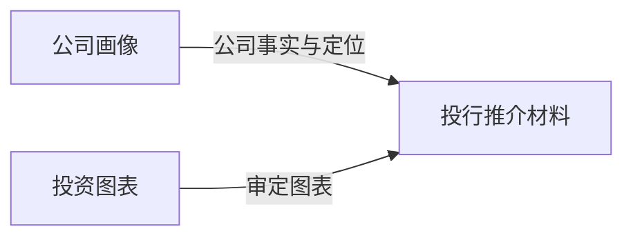
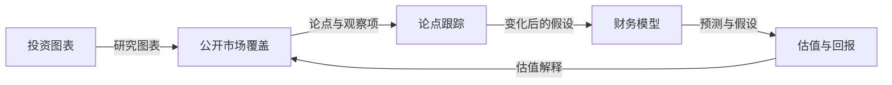
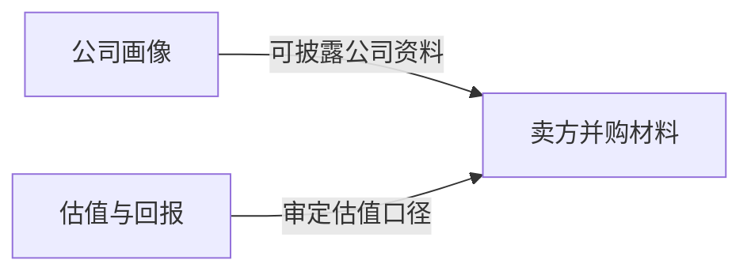
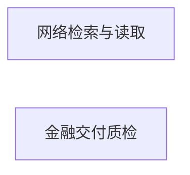

# Capital Markets Desk

面向公司画像、银行家材料、卖方 M&A、公开市场覆盖、财务模型和估值的长期工作场。

## 适合做什么

公司 one-pager、交易材料、Pitch Deck、卖方 M&A 材料、公开市场覆盖报告、财务模型、估值、论点跟踪、图表包和最终金融文档质检。

## 会用到哪些资料

AI 先了解你的长期要求和可用技能，再按交付需要读取客户材料、模型、交易口径、市场数据、历史成品和模板。

## 技能怎么配合

按你要交付的材料组合技能：公司画像可以单独完成；已有审定模型，可以直接制作估值说明和图表；交易材料再按需要组合其他技能。

## 开始前需要确认

所有财务数字、交易口径和客户结论必须来自获准材料。缺少模板或审定输入时不伪造可交付状态；外发、交易、付费数据和登录继续要求明确授权。

## 会得到什么，如何改进

可以得到公司画像、推介材料、交易材料、覆盖报告、模型、估值和图表。模板问题在对应技能中改进；工作方式持续变化时再调整模式。

## 公司介绍与推介

## 公开市场覆盖与跟踪

## 卖方交易材料

## 通用能力

