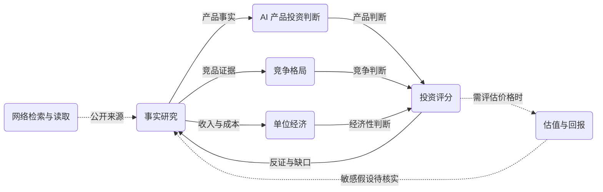
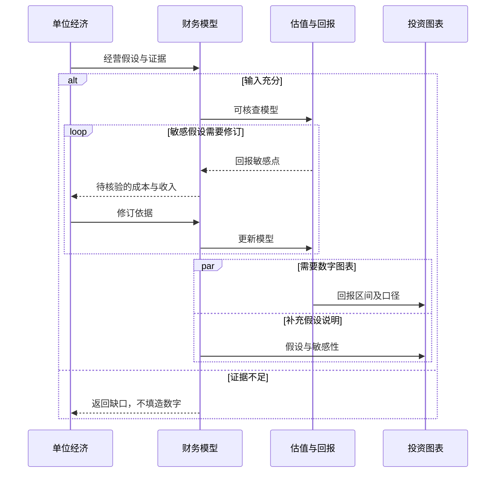
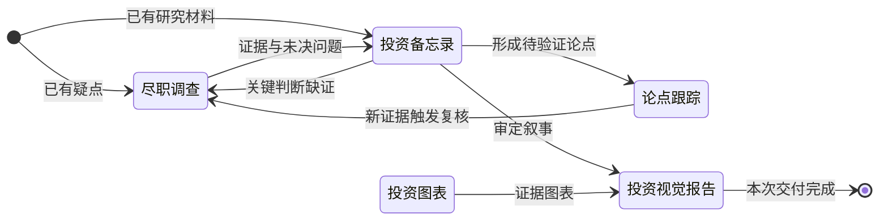
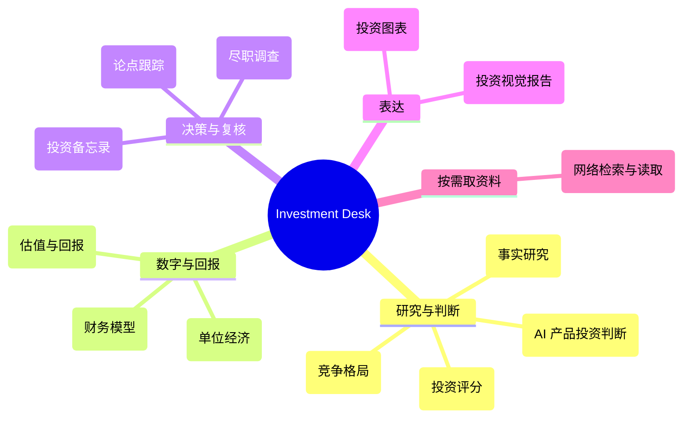

# Investment Desk

面向私募、AI 项目和复杂投资判断的长期研究工作场。

## 适合做什么

事实研究、AI 产品判断、竞争格局、单位经济、投资评分、财务模型、估值回报、尽调、论点跟踪、IC Memo、投资图表与视觉报告。

## 会用到哪些资料

AI 先了解你的长期要求和可用技能，再按当前问题读取公司材料、PDF、模型、来源证据、历史项目及反馈。

## 技能怎么配合

围绕你要完成的研究选择技能。已有公司资料，可以直接做估值、尽调或投资备忘录；需要补充事实时，再调用研究技能。

## 开始前需要确认

缺失事实不能填零或伪造。对外发送、付费数据、登录、投资操作与任何具有现实金融影响的动作继续要求用户明确授权。本 Mode 不自动承担公开市场持续覆盖。

## 会得到什么，如何改进

可以得到研究资料、评分卡、财务模型、估值、尽调清单、投资备忘录和图表报告。单次问题在当前项目修正；反复需要的新方法再补充到技能或工作模式。

以下图按不同视角描述技能协作，AI 依当前问题选择适用部分；分支、往返与并行关系不强制执行顺序。

## 项目初筛与反证

## 模型与回报推演

## 尽调、决策材料与跟踪

## 技能分工

## 通用能力

